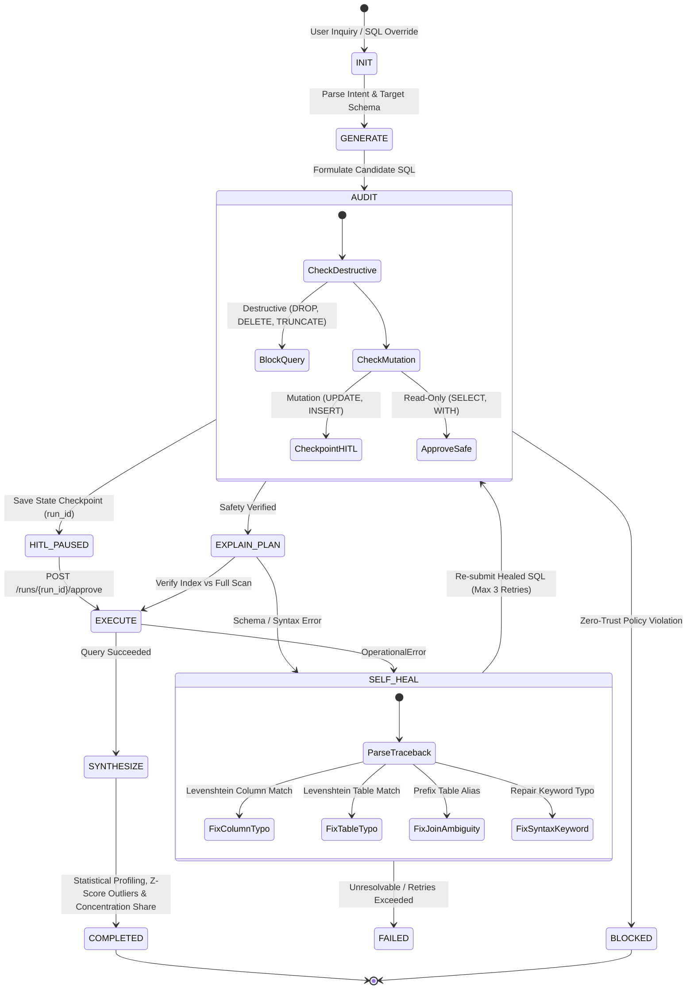

# Autonomous Data Analyst Agent, Query Plan Analyzer & Self-Healing SQL Engine

[](https://github.com/yakupakcy36/autonomous-data-analyst-agent/actions)
[](https://www.python.org/downloads/)
[](https://fastapi.tiangolo.com/)
[](https://opensource.org/licenses/MIT)

An enterprise autonomous AI agent engineered as a **cyclic finite state machine (FSM)** for database analytics. Features **sandboxed query execution**, **`EXPLAIN QUERY PLAN` cost & index verification**, **multi-pattern self-healing SQL recovery**, **automated statistical data profiling**, and **stateful Human-in-the-Loop (HITL) checkpointing** for mutating operations.

Operates 100% locally with **zero external paid API dependencies**.

---

## 🏛️ State Machine Architecture



---

## 🛡️ Zero-Trust Security, HITL Checkpointing & Self-Healing

1. **Stateful Human-in-the-Loop (HITL) Checkpoints:**  
   When a state-mutating query (`UPDATE`, `INSERT`) is detected, execution halts in the `HITL_PAUSED` state and persists the execution trajectory under a unique `run_id`. An administrator can inspect and resume the transaction via `POST /runs/{run_id}/approve`.
2. **`EXPLAIN QUERY PLAN` Pre-Execution Gate:**  
   Prior to running analytical queries, the agent inspects the SQLite query planner to determine whether execution utilizes B-Tree indexes (`INDEX_SEARCH`) or requires a full table scan (`FULL_TABLE_SCAN`).
3. **Multi-Pattern Self-Healing Engine:**  
   Recovers automatically from:
   - Column misspellings (`no such column: annual_spending` $\to$ `annual_spend`)
   - Table misspellings (`no such table: customer` $\to$ `customers`)
   - Ambiguous join references (`ambiguous column name: customer_id` $\to$ `customers.customer_id`)
   - Keyword syntax errors (`near "FORM": syntax error` $\to$ `FROM`)
4. **Automated Statistical Result Profiling:**  
   Computes mean, standard deviation, min/max, Z-score anomalies ($|z| > 1.8$), and Pareto concentration ratios across returned datasets.

---

## 📁 Repository Structure

```text
autonomous-data-analyst-agent/
├── .github/workflows/ci.yml     # Automated GitHub Actions CI pipeline
├── src/
│   ├── config.py                # Agent state limits, security keywords, timeouts
│   ├── database.py              # Indexed SQLite sandbox & EXPLAIN QUERY PLAN
│   ├── safety.py                # Zero-trust SQL safety auditor & HITL gate
│   ├── generator.py             # Multi-pattern SQL generator & self-healer
│   ├── profiler.py              # Z-score anomaly & Pareto concentration profiler
│   └── agent.py                 # Cyclic FSM orchestrator & HITL checkpoint store
├── api/
│   ├── schemas.py               # Pydantic v2 validation schemas
│   └── app.py                   # FastAPI server (/query, /runs/{id}/approve, /audit)
├── tests/                       # Comprehensive unit & integration test suite
├── Dockerfile                   # Production container definition
├── docker-compose.yml           # Local service orchestration
└── requirements.txt
```

---

## 🚀 Quickstart & Reproduction

```bash
# 1. Install dependencies
pip install -r requirements.txt

# 2. Execute test suite
pytest -v

# 3. Launch production API
uvicorn api.app:app --host 0.0.0.0 --port 8000
```

---

## 📡 API Reference

* **`POST /query`**: Executes natural language analytics or raw `sql_override` through the full cyclic state machine, returning data, `query_plan`, `statistical_profile`, and state `trajectory`.
* **`POST /runs/{run_id}/approve`**: Approves and commits a paused `HITL_PAUSED` mutation checkpoint.
* **`POST /audit`**: Performs static policy auditing on arbitrary SQL strings.
* **`GET /schema`**: Returns active database tables and column definitions.

---

## 📄 License
MIT License.
